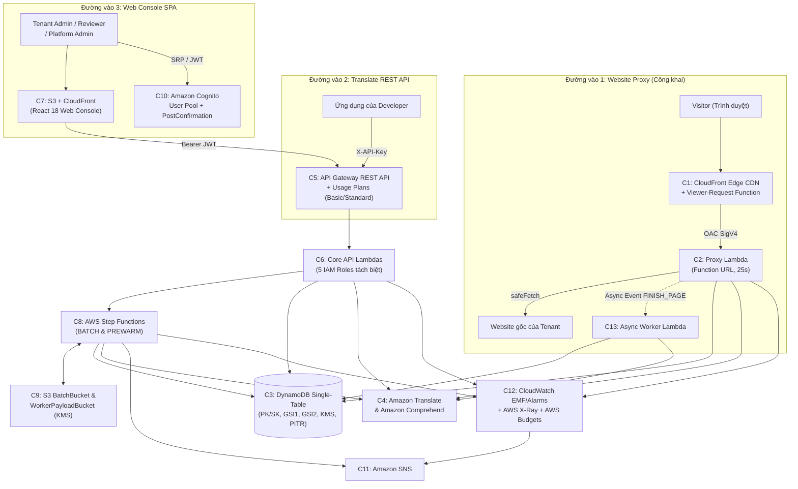

# TranslateMe – Multi-Tenant Smart Translation Gateway on AWS

[-FF9900?logo=amazon-aws&logoColor=white)](#kiến-trúc-hệ-thống-trên-aws)
[](#cấu-trúc-kho-mã-nguồn)
[](#cấu-trúc-kho-mã-nguồn)
[-EF4444?logo=amazon-aws&logoColor=white)](#hướng-dẫn-triển-khai-lên-aws-deployment-steps)
[-10B981)](#kiểm-thử--8-kịch-bản-nghiệm-thu)

**TranslateMe** là nền tảng cổng dịch thuật thông minh đa khách hàng (*Multi-Tenant Smart Translation Gateway*) được xây dựng hoàn toàn phi máy chủ (*serverless*) trên đám mây **Amazon Web Services (AWS)**. Dự án được thực hiện trong khuôn khổ học phần **Điện toán đám mây (`INT3319_1`)** tại **Trường Đại học Công nghệ – ĐHQGHN (UET-VNU)**.

Hệ thống giải quyết bài toán bản địa hóa đa ngôn ngữ cho các doanh nghiệp vừa và nhỏ thông qua **hai sản phẩm tích hợp dùng chung một lõi xử lý**:
1. **Sản phẩm A – Website Proxy (`F1, F2, F6`):** Dịch trực tiếp một website sẵn có sang nhiều ngôn ngữ đích qua CDN biên (`https://<cloudfront-domain>/<slug>/<lang>/<path>`) mà **không cần chỉnh sửa mã nguồn của website gốc**, giữ nguyên toàn bộ bố cục HTML/CSS/JS và thẻ định dạng nội tuyến.
2. **Sản phẩm B – Translate API (`F9, F10`):** Cung cấp REST API dịch văn bản thời gian thực (`POST /translate/realtime`) và dịch tệp tài liệu hàng loạt bất đồng bộ (`.txt`, `.html`, `.docx` `≤ 10 MB`) giữ nguyên cấu trúc đoạn văn, bảng biểu và định dạng chữ.

---

## Thành viên Nhóm 03 (`INT3319_1`)

| STT | Họ và tên | MSSV | Vai trò | Ngày công KH (Có đệm) | Điểm đóng góp (Thang 100) | Phân hệ phụ trách chính |
| :-: | :--- | :---: | :---: | :---: | :---: | :--- |
| 1 | **Nguyễn Thị Thu Huyền** | `24021523` | Nhóm trưởng (TV1) | `22,5` (`23,5`) | **`24,9 / 100`** (`24,9%`) | Bảng đơn DynamoDB + KMS, cô lập tenant qua IAM `dynamodb:LeadingKeys`, Cognito Auth, đặt trước/tất toán hạn mức nguyên tử, Platform Admin, kiểm thử E2E (`isolation`, `limits`, `ssrf`). |
| 2 | **Hoàng Hải Phong** | `24020267` | Thành viên (TV2) | `22,5` (`24,5`) | **`25,6 / 100`** (`25,6%`) | Tách câu HTML bảo toàn thẻ `{n}`, lõi dịch Proxy song song + trang dịch dở 20s & `C13 Worker`, Bộ nhớ dịch (TM), Glossary CSV, chỉ mục `SEG` & xóa cache chọn lọc, IaC 7 stack & script deploy 2 lượt. |
| 3 | **Trương Duy Toàn** | `24021643` | Thành viên (TV3) | `22,5` (`23,5`) | **`25,0 / 100`** (`25,0%`) | Bộ tải `safeFetch` chống SSRF/DNS Rebinding, chia khối UTF-8 `≤ 9.000 byte`, xác minh website (`META`/`FILE`), API `/translate/realtime`, quản lý API key 1 lần, Prewarm Sitemap, Step Functions `BATCH`. |
| 4 | **Phạm Kim Tùng** | `24021667` | Thành viên (TV4) | `22,5` (`24,0`) | **`24,5 / 100`** (`24,5%`) | Ứng dụng Web Console React (`Q1–Q5, Q7–Q9`) tích hợp Cognito, API duyệt song ngữ (`expected_version`), bộ phân tích/dựng tệp `DOCX` chống ZIP bomb/XXE & gắn phông Đông Á, `obs.ts`, bộ mẫu `samples/` & `site-1-homestay`. |
| **Tổng** | **4 thành viên** | — | — | **`90,0` (`95,5`)** | **`100,0 / 100` (`100,0%`)** | **Hoàn thành 100% (45/45 hạng mục WBS & 8/8 kịch bản nghiệm thu)** |

---

## 5 Giá trị gia tăng cốt lõi so với gọi trực tiếp Amazon Translate

1. **Bộ nhớ dịch dùng chung (Translation Memory – TM):** Chuẩn hóa văn bản Unicode NFC, mã hóa thẻ nội tuyến `{n}…{/n}` và băm SHA-256 làm khóa tra cứu lô (`BatchGetItem`). Câu trùng lặp được trả về tức thời từ DynamoDB với **chi phí dịch máy bằng 0**, dùng chung xuyên suốt giữa Website Proxy và Translate API.
2. **Bảng thuật ngữ chuyên ngành (Glossary `KEEP` / `FIXED`):** Cho phép khách hàng quản lý thuật ngữ giữ nguyên (`KEEP`, ví dụ tên thương hiệu) hoặc dịch cố định (`FIXED`), nhập/xuất CSV, đồng bộ `ImportTerminology` sang Amazon Translate, tự động gắn cờ `stale = true` khi cập nhật thuật ngữ và hậu kiểm sau dịch.
3. **Duyệt bản dịch (Human-in-the-loop) & Xóa cache CloudFront chọn lọc:** Biên tập viên (`Reviewer`) chỉnh sửa câu dịch ngay trên giao diện song ngữ (có kiểm tra khóa lạc quan `expected_version` chống ghi đè). Bản dịch người (`label = HUMAN`) được bảo vệ vĩnh viễn trước dịch máy, đồng thời hệ thống tra chỉ mục câu – trang (`SEG`) để gọi `CreateInvalidation` **chỉ xóa cache đúng các trang chứa câu vừa sửa**.
4. **Ngân sách thời gian 20 giây & Hoàn tất nền bất đồng bộ:** Nếu trang web gốc có quá nhiều câu mới chưa kịp dịch hết trong 20 giây đầu, `C2 Proxy` trả ngay **trang dịch dở** (`HTTP 200`, `X-TranslateMe-Partial: 1`, `Cache-Control: no-store`, tự tải lại sau 5 giây) và kích hoạt `C13 Async Worker` (kèm khóa `PG_LOCK`) để dịch nốt vào TM ở chế độ nền, tránh lỗi `504 Gateway Timeout`.
5. **Cô lập đa khách hàng 2 lớp, chống SSRF & Kiểm soát hạn mức nguyên tử:**
   - **Cô lập dữ liệu 2 lớp:** Kiểm tra `TenantContext` ở tầng ứng dụng kết hợp gọi `STS AssumeRole` với **IAM Session Policy động** gắn điều kiện `dynamodb:LeadingKeys = ["TENANT#<tenantId>"]` để AWS kiểm tra và từ chối truy cập chéo ngay ở tầng phân quyền dịch vụ.
   - **Chống SSRF & DNS Rebinding (`safeFetch`):** Chặn toàn bộ dải IP nội bộ/loopback/IMDS (`169.254.169.254`), chỉ cho phép cổng `80/443`, phân giải DNS một lần và ghim cứng IP (`createPinnedLookup`), kiểm tra lại từng bước chuyển hướng `302` và tước bỏ `Cookie`/`Authorization`.
   - **Hạn mức ký tự nguyên tử:** Đặt trước (`reserveChars`), hoàn trả (`releaseChars`) và tất toán (`settleUsage`) nguyên tử trên DynamoDB; khi chạm trần ký tự tháng, các câu đã có trong TM (`R = 0`) vẫn được phục vụ bình thường (`200 OK`).

---

## Kiến trúc hệ thống trên AWS

Hệ thống được triển khai tại vùng **`ap-southeast-1` (Singapore)** gồm **13 thành phần (`C1–C13`)** tiếp nhận yêu cầu qua **3 đường vào độc lập**:



---

## Cấu trúc kho mã nguồn

Kho mã nguồn được tổ chức theo cấu trúc **Monorepo TypeScript**:

```text
TranslateMe/
├── libs/common/                 # Thư viện lõi dùng chung (9 nhóm mô-đun chức năng / 27 tệp .ts)
│   ├── types.ts, db.ts, tenant.ts, tenantAws.ts, roles.ts, jobs.ts, siteSlug.ts, cors.ts
│   ├── safeFetch.ts             # Bộ tải HTTP an toàn chống SSRF, DNS Rebinding & lộ header
│   ├── segmenter.ts, extract.ts, htmlDom.ts, markers.ts, rebuild.ts, text-utils.ts, translator.ts
│   ├── tm.ts, seg.ts, invalidation.ts, glossary.ts
│   ├── usage/usage.ts           # Đặt trước, hoàn trả và tất toán hạn mức nguyên tử
│   ├── parsers.ts, docx.ts      # Phân tích & dựng lại TXT, HTML, DOCX (chống ZIP bomb/XXE)
│   ├── experiments/             # Thí nghiệm thăm dò Amazon Translate & Comprehend
│   └── test/                    # 22 tệp kiểm thử đơn vị & kiểm thử thuộc tính (fast-check)
├── services/
│   ├── proxy/                   # C2 Website Proxy (handler.ts), C13 Worker (worker.ts), obs.ts + 8 tệp test
│   └── api/                     # C5/C6/C8 REST API & Step Functions Workers + 16 tệp test
│       ├── auth/                # Ngữ cảnh xác thực, mời thành viên Cognito & PostConfirmation
│       ├── sites/               # Quản lý & xác minh quyền sở hữu website (META / FILE)
│       ├── translate/           # API dịch văn bản thời gian thực POST /translate/realtime
│       ├── batch/               # S3 Presigned URL, Step Functions BATCH & PREWARM Sitemap
│       ├── glossary/            # Quản lý thuật ngữ KEEP/FIXED & nhập/xuất CSV
│       ├── review/              # Duyệt bản dịch song ngữ (expected_version) & xóa cache chọn lọc
│       ├── keys/                # Cấp phát API key 1 lần (SHA-256) & gắn Usage Plan
│       └── platform/            # Quản trị nền tảng, đổi gói/hạn mức & khóa/mở khóa tenant
├── console/                     # C7 Ứng dụng Web Console (React 18 + TypeScript + Vite) + 10 tệp test
├── infra/
│   ├── stacks/                  # 8 mẫu CloudFormation: bootstrap, data, identity, api, edge, workflow, console, ops
│   ├── modules/                 # Các nested stack (iam, lambdas, api-gateway, data, workflow)
│   ├── functions/               # CloudFront Function viewer-request.js
│   └── tests/                   # Kiểm thử cấu trúc bảng & di trú dữ liệu
├── e2e/
│   ├── demo/                    # Công cụ tự động hóa: deploy.ts, seed.ts, preflight.ts, latency.ts, kb8.ts
│   ├── sites/                   # Trình sinh 3 website tĩnh phục vụ thực nghiệm (Site A, Site B, Site C)
│   └── tests/                   # 12 bộ kiểm thử E2E hộp đen (isolation, limits, ssrf, deploy, ...)
├── samples/                     # Bộ dữ liệu mẫu: thuat-ngu.csv, gioi-thieu-homestay.docx, test-1000-sentences.py/ts
├── demo-sites/site-1-homestay/  # Website Homestay thực nghiệm phục vụ kịch bản Demo trực tiếp
└── docs/                        # Tài liệu thiết kế chi tiết, OpenAPI 3.0 & báo cáo bằng chứng thực nghiệm
```

---

## Hướng dẫn triển khai lên AWS (Deployment Steps)

Chi tiết đầy đủ xem tại [`docs/deploy.md`](docs/deploy.md). Một lệnh `npm run demo:deploy` tự động biên dịch TypeScript, đóng gói Lambda theo mã băm SHA-256, triển khai ngăn xếp `bootstrap` + **7 ngăn xếp CloudFormation** theo cơ chế **2 lượt (Two-Pass)** để giải quyết phụ thuộc vòng giữa Cognito – API – CloudFront, sau đó build và phát hành Web Console lên S3/CloudFront.

### 1. Chuẩn bị môi trường
- **Yêu cầu:** `Node.js 20+`, `npm`, `AWS CLI v2` (đã cấu hình tài khoản AWS đích tại vùng `ap-southeast-1`), và tiện ích `zip` (hoặc `python3` dự phòng để nén gói `.zip` và chạy script tải mẫu).
- Cài đặt gói phụ thuộc và tạo tệp cấu hình `e2e/.env.dev`:

```bash
cd e2e
npm ci

cat <<EOF > .env.dev
TM_STAGE=dev
TM_ACCOUNT=941490574112
TM_REGION=ap-southeast-1
TM_ALERT_EMAIL=your-email@example.com
TM_MONTHLY_BUDGET_USD=20
EOF
```

### 2. Kiểm tra tiền điều kiện & Triển khai tự động 7 ngăn xếp
```bash
cd e2e
set -a; . ./.env.dev; set +a

# Bước 1: Kiểm tra kết nối STS, Amazon Translate, Lambda Quotas & AWS Budgets
npm run demo:preflight

# Bước 2: Xem trước kế hoạch triển khai (Dry-run)
npm run demo:deploy -- --stage dev --dry-run

# Bước 3: Triển khai toàn bộ hệ thống (Bootstrap + 7 Stack Lượt 1 + Lượt 2 + Web Console)
npm run demo:deploy -- --stage dev
```

Thứ tự các ngăn xếp CloudFormation được công cụ `deploy.ts` tự động điều phối:
1. `translateme-<stage>-bootstrap`: S3 `CodeBucket` chứa gói `.zip` của Lambda.
2. `translateme-<stage>-data`: Bảng đơn DynamoDB `translateme-<stage>` (`GSI1`, `GSI2`, `PITR`, `TTL`), khóa KMS Customer Managed Key, `BatchBucket`, `WorkerPayloadBucket`.
3. `translateme-<stage>-identity`: Cognito User Pool, 2 App Client (`console`, `platform`), nhóm `PlatformAdmins`.
4. `translateme-<stage>-api`: 5 vai trò IAM thực thi + 3 vai trò phiên `TenantDataRole`, 13 hàm Lambda, Proxy Function URL, API Gateway REST API + Usage Plans (`Basic`, `Standard`).
5. `translateme-<stage>-edge`: CloudFront Distribution cho Website Proxy, OAC (`AWS_IAM` ký SigV4 vào Function URL), CloudFront Function `viewer-request.js`.
6. `translateme-<stage>-workflow`: 2 máy trạng thái AWS Step Functions (`BATCH` và `PREWARM`).
7. `translateme-<stage>-console`: S3 Bucket + CloudFront Distribution cho giao diện Web Console SPA.
8. `translateme-<stage>-ops`: Ngân sách AWS Budgets (`50%`, `80%`, dự báo `100%`), chủ đề SNS và CloudWatch Alarms.
9. **Lượt 2 (Pass 2) & Web Console:** Cập nhật trigger `PostConfirmation` cho `identity`, truyền `CloudFrontDistributionId` & `PublicBaseUrl` vào `api`, build React SPA với biến `VITE_*`, đồng bộ lên S3 và xóa cache `/*`.

### 3. Khởi tạo dữ liệu hạt giống (`seed`) & Kiểm tra hậu triển khai
```bash
# Nạp các biến đầu ra CloudFormation vừa sinh vào .env.dev
cat .build/dev/e2e.env >> .env.dev
set -a; . ./.env.dev; set +a

# Sinh 3 website mẫu, khởi tạo cấu hình PLATFORM#CONFIG, 3 tenant mẫu, API key và thuật ngữ
npm run sites:build
npm run demo:seed -- all

# Kiểm tra tất cả 7 ngăn xếp ở trạng thái COMPLETE và xác nhận kết nối tới mọi điểm cuối
npm run demo:preflight -- --post
```

---

## Kiểm thử & 8 kịch bản nghiệm thu

### 1. Chạy bộ 71 tệp kiểm thử tự động tại máy cục bộ
```bash
# Kiểm thử đơn vị & kiểm thử thuộc tính (fast-check) cho thư viện lõi (22 tệp)
cd libs/common && npm test

# Kiểm thử dịch vụ Website Proxy (8 tệp) và Core API (16 tệp)
cd ../../services/proxy && npm test
cd ../api && npm test

# Kiểm thử giao diện Web Console (10 tệp) và kịch bản E2E/Hạ tầng (15 tệp)
cd ../../console && npm test
cd ../e2e && npm test
python3 -m unittest discover -s ../infra/tests -p "test_*.py"
```

### 2. Thực thi 8 kịch bản nghiệm thu trên môi trường AWS (`KB1 – KB8`)

| Kịch bản | Lệnh thực thi kiểm chứng | Tiêu chí thiết kế | Kết quả đạt được |
| :--- | :--- | :--- | :--- |
| **KB1 – Bộ nhớ dịch (TM) với tải 1.000 câu (`40%` lặp)** | `python3 samples/test-1000-sentences.py --dry-run`<br>`npx tsx samples/test-1000-sentences.ts` | Lượt 1 trúng TM `40%` (`machineChars = 28.200`); Lượt 2 trúng `100%` (`+0` dịch máy); lệch `USAGE ≤ 1%`. | Lượt 1 trúng **`40,0%`**, Lượt 2 trúng **`100,0%`**, lệch `0` ký tự (`0,00%`), thời gian giảm từ `14,2s` xuống **`2,1s`**. |
| **KB2 – Chi phí tránh được & Lượng dùng đa nguồn** | Kiểm tra `GET /console/usage` & màn hình `Q5` sau KB1 | Sai số chi phí tránh được `≤ 0,01 USD` (đơn giá tham chiếu AWS Translate `15 USD / 1M` ký tự). | Chi phí dịch máy `0,42 USD`, chi phí tránh được nhờ TM **`0,99 USD`** (`65.800` ký tự), sai số **`0,00 USD`**. |
| **KB3 – Độ trễ Website Proxy qua 3 trạng thái cache** | `cd e2e && npm run demo:latency` | Trang ~100 câu: TM rỗng `< 30s`; trúng TM `P50 ≤ 2.000ms`; trúng CDN `P50 ≤ 300ms`. | TM rỗng: **`P50 = 3.840 ms`**; Trúng TM (`Miss` CDN): **`P50 = 418 ms`**; Trúng CloudFront (`Hit`): **`P50 = 46 ms`**. |
| **KB4 – Cô lập dữ liệu đa khách hàng (Multi-tenant)** | `cd e2e && npm run test:isolation` | `8/8` phép thử dương `200 OK`; `8/8` phép thử chéo bị chặn (`404 NOT_FOUND` đồng nhất); Admin bị chặn đọc TM. | Đạt **`20/20` phép thử** (`P1–P8`, `X1–X8`, `E1–E4`); truy cập chéo trả `404` đồng nhất; Admin đọc TM trả `403`. |
| **KB5 – Giới hạn tốc độ, Hạn mức & Khóa Tenant** | `cd e2e && npm run test:limits` | Tách biệt 3 mã `429`; câu trong TM vẫn trả `200` khi hết hạn mức; khóa Tenant A trả `302` trong `≤ 60s`. | Đạt **`5/5` phép thử (`L1–L5`)**; khóa Tenant A chuyển hướng `302` sau **`11,4 giây`** (`≤ 60s`), Tenant B vẫn `200 OK`. |
| **KB6 – Phòng chống tấn công SSRF (9 đích độc hại)** | `cd e2e && npm run test:ssrf` | Chặn `9/9` đích (IMDS `169.254.169.254`, localhost, IPv4/IPv6 nội bộ, DNS Rebinding, 302 redirect, cổng 22). | Đạt **`9/9` tình huống (`6.1–6.9`)**: `0` kết nối nội bộ, `0` rò rỉ `Cookie`/`Authorization` (`S8H`). |
| **KB7 – Dịch tệp hàng loạt `DOCX` bất đồng bộ** | Tải `samples/gioi-thieu-homestay.docx` (`en, ko`) qua `Q9` | Hoàn tất `SUCCEEDED`; giữ nguyên số đoạn `w:p`, ô bảng `w:tc`, chữ đậm `{n}`, phông `w:eastAsia` và `warnings`. | Hoàn tất sau **`~6,8 giây`**; bảo toàn **`34/34` đoạn `w:p`**, **`28/28` ô bảng `w:tc`**, gắn đúng phông tiếng Hàn & `warnings`. |
| **KB8 – Duyệt bản dịch & Xóa cache chọn lọc** | `cd e2e && npm run demo:kb8 -- --prepare` | Sửa câu `X` (`en`) trên `Site C`: chỉ xóa cache đúng 2 trang chứa câu `X`, trang thứ 3 và bản `ko` vẫn `Hit`. | Đạt **`8/8` chốt (`K1–K8`)**: `CreateInvalidation` chỉ gửi đúng 2 đường dẫn `en/trang-1,2/`; các trang khác giữ nguyên `Hit`. |

---

## Tài liệu kỹ thuật chi tiết (`docs/`)

- [`docs/deploy.md`](docs/deploy.md): Hướng dẫn triển khai, nâng cấp và gỡ bỏ 7 ngăn xếp CloudFormation.
- [`docs/openapi.yaml`](docs/openapi.yaml): Đặc tả giao diện REST API theo chuẩn OpenAPI 3.0.
- [`docs/translate-findings.md`](docs/translate-findings.md): Kết quả thực nghiệm bảo toàn thẻ nội tuyến `<span data-i>` trên Amazon Translate và ngưỡng nhận diện ngôn ngữ `0,70` trên Amazon Comprehend.
- [`docs/ssrf-scenario6-evidence.md`](docs/ssrf-scenario6-evidence.md): Hồ sơ bằng chứng kiểm chứng 9 kịch bản chống SSRF & DNS Rebinding (`6.1–6.9`).
- [`docs/invalidation.md`](docs/invalidation.md): Thiết kế chỉ mục câu – trang (`SEG`) và thuật toán xóa cache CloudFront chọn lọc.
- [`docs/limits.md`](docs/limits.md): Cơ chế đặt trước hạn mức ký tự nguyên tử, Usage Plans và khóa Tenant tức thời.
- [`docs/parsers.md`](docs/parsers.md): Đặc tả bộ phân tích và dựng lại tệp `.txt`, `.html`, `.docx` bảo toàn định dạng.
- [`docs/prewarm.md`](docs/prewarm.md): Thiết kế máy trạng thái Step Functions `PREWARM` dịch trước website theo `sitemap.xml`.
